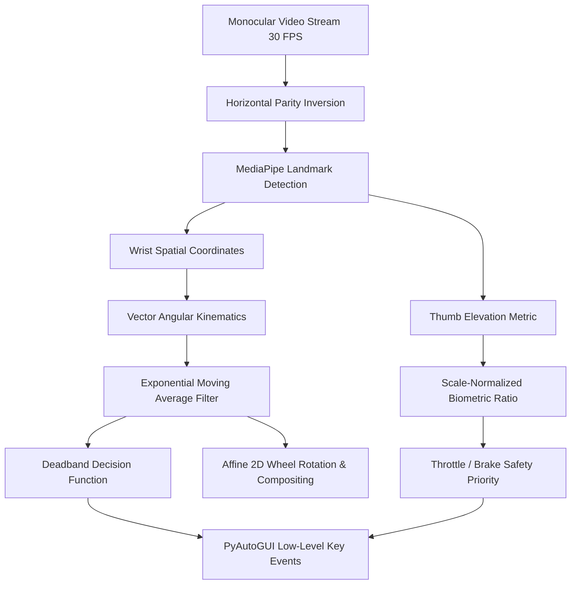

# VirtualWeelo 🏎️
> **Real-Time Biomechanical Hand-Kinematics & Gesture Steering Controller**

[](https://www.python.org/)
[](https://opencv.org/)
[](https://developers.google.com/mediapipe)
[](https://opensource.org/licenses/MIT)

VirtualWeelo converts non-intrusive monocular webcam feeds into continuous game telemetric inputs (`W`, `A`, `S`, `D`). By modeling hand keypoints as spatial kinematic vectors in $\mathbb{R}^2$ and applying scale-invariant anthropometric geometry, VirtualWeelo eliminates physical gaming wheels and gamepads while maintaining zero hardware latency.

---

## 📐 Mathematical Formulation & Mechanics



---

### 1. Spatial Coordinate Mapping & Parity Inversion

Let an incoming monocular frame from the video capture pipeline be an RGB tensor $I \in \mathbb{R}^{H \times W \times 3}$. To provide intuitive proprioceptive feedback, the frame is reflected across its vertical axis:

$$I_{\text{mirrored}}(x, y) = I(W - 1 - x, y)$$

MediaPipe detects $N \le 2$ hands, each parameterized by 21 landmarks $\mathbf{l}_i = (x_i, y_i, z_i) \in [0, 1]^3$. Landmark positions are projected to screen coordinates $\mathbf{P}_i \in \mathbb{R}^2$:

$$\mathbf{P}_i = \begin{pmatrix} x_i \cdot W \\ y_i \cdot H \end{pmatrix}$$

Detected hands are spatially partitioned into left and right hands by sorting their wrist positions $\mathbf{P}_0 = (x_0, y_0)$ along the abscissa:

$$\text{Hand}_{\text{left}} = \arg\min_h x_{0, h}, \quad \text{Hand}_{\text{right}} = \arg\max_h x_{0, h}$$

---

### 2. Angular Kinematics & Steering Formulation

Let $\mathbf{P}_L = (x_L, y_L)$ and $\mathbf{P}_R = (x_R, y_R)$ be the wrist coordinates ($lm[0]$) of the left and right hands, respectively. The steering vector $\mathbf{v} \in \mathbb{R}^2$ connecting both hands is:

$$\mathbf{v} = \mathbf{P}_R - \mathbf{P}_L = \begin{pmatrix} x_R - x_L \\ y_R - y_L \end{pmatrix} = \begin{pmatrix} \Delta x \\ \Delta y \end{pmatrix}$$

The unconstrained instantaneous steering angle $\theta_{\text{raw}}$ in degrees is computed via the four-quadrant inverse tangent:

$$\theta_{\text{raw}} = \operatorname{atan2}(\Delta y, \Delta x) \cdot \frac{180^\circ}{\pi}$$

---

### 3. Discrete Low-Pass Filtering (Jitter Attenuation)

High-frequency hand tremors and optical tracking noise are filtered using a first-order recursive Exponential Moving Average (EMA) low-pass filter:

$$\theta_t = (1 - \alpha) \cdot \theta_{t-1} + \alpha \cdot \theta_{\text{raw}}$$

* **Smoothing Factor**: $\alpha = 0.20$ (retention factor $\beta = 1 - \alpha = 0.80$)
* **Step Response**: Eliminates noisy frame-to-frame oscillations while delivering minimal phase lag ($\approx 33\text{ ms}$ at 30 FPS).

---

### 4. Deadband Steering Decision Function

To enable straight-line driving without micro-oscillations, a symmetric deadband threshold $\theta_{\text{threshold}} = 7.0^\circ$ defines the piecewise control policy:

$$\text{Steering State} = \begin{cases} 
\text{Turn Left} \implies \text{keyDown}('a'), \text{keyUp}('d'), & \theta_t < -\theta_{\text{threshold}} \\
\text{Turn Right} \implies \text{keyDown}('d'), \text{keyUp}('a'), & \theta_t > +\theta_{\text{threshold}} \\
\text{Neutral} \implies \text{keyUp}('a'), \text{keyUp}('d'), & |\theta_t| \le \theta_{\text{threshold}}
\end{cases}$$

---

### 5. Anthropometric Scale-Invariant Thumb Elevation

To accommodate varying distances between the user and camera, biometric gestures must be independent of absolute pixel dimensions.

1. **Palm Characteristic Height**:
   Measured between the wrist ($lm[0]$) and middle metacarpophalangeal joint ($lm[9]$), with a floor $\epsilon = 0.05$ preventing division by zero:
   $$h_{\text{hand}} = \max\left(|y_{\text{wrist}} - y_{\text{middle\_mcp}}|, \, 0.05\right)$$

2. **Normalized Vertical Elevation**:
   Evaluated between thumb tip ($lm[4]$), index MCP ($lm[5]$), and thumb MCP ($lm[2]$):
   $$\Delta y_{\text{index}} = \frac{y_{\text{index\_mcp}} - y_{\text{thumb\_tip}}}{h_{\text{hand}}}$$
   $$\Delta y_{\text{mcp}} = \frac{y_{\text{thumb\_mcp}} - y_{\text{thumb\_tip}}}{h_{\text{hand}}}$$
   $$\mathcal{E}_{\text{thumb}} = \min\left(\Delta y_{\text{index}}, \Delta y_{\text{mcp}}\right)$$

3. **Classification Rule**:
   $$\text{Thumb Up} \iff \mathcal{E}_{\text{thumb}} > \tau_{\text{elevation}} \quad (\tau_{\text{elevation}} = 0.20)$$

---

### 6. Throttle & Brake Dynamics with Safety Override

* **Throttle (Gas, `W`)**: Right hand thumb elevation active ($\mathcal{E}_{\text{right}} > 0.20$).
* **Brake (Reverse, `S`)**: Left hand thumb elevation active ($\mathcal{E}_{\text{left}} > 0.20$).
* **Safety Invariant (Brake Precedence)**: If both gas and brake conditions are triggered simultaneously, brake overrides gas to simulate automotive safety systems:
  $$\text{Gas Active} \iff \text{Right Thumb Up} \land \neg \text{Brake Active}$$

---

### 7. Affine Graphic Transformation & Alpha Compositing

The steering wheel HUD graphic is dynamically transformed in $\mathbb{R}^2$ via an affine Euclidean similarity transform:

$$M = \begin{bmatrix}
\cos(-\theta_t) & -\sin(-\theta_t) & c_x (1 - \cos(-\theta_t)) + c_y \sin(-\theta_t) \\
\sin(-\theta_t) & \cos(-\theta_t) & c_y (1 - \cos(-\theta_t)) - c_x \sin(-\theta_t)
\end{bmatrix}$$

The rotated RGBA wheel overlay is blended onto the background frame $I_{\text{bg}}$ via Porter-Duff alpha composition:

$$I_{\text{out}}(x, y) = \alpha_{\text{eff}} \cdot I_{\text{wheel}}(x, y) + (1 - \alpha_{\text{eff}}) \cdot I_{\text{bg}}(x, y)$$

where $\alpha_{\text{eff}} = \gamma \cdot \left(\frac{\alpha_{\text{wheel}}}{255}\right)$, with $\gamma \in [0.85, 0.95]$ dynamically increasing opacity when steering occurs.

---

### 8. Failsafe Watchdog & Zero-Latency Execution

* **Optical Tracking Loss Watchdog**: If hand landmarks are lost for $k > 5$ consecutive frames ($t > 166\text{ ms}$), all active virtual keystrokes (`W`, `A`, `S`, `D`) are automatically released to prevent stuck acceleration or uncontrollable turning.
* **PyAutoGUI Timing**: Internal delays are zeroed (`PAUSE = 0.0`, `FAILSAFE = False`) for instantaneous input dispatch.

---

## ⚡ Quick Start

### 1. Clone Repository
```bash
git clone https://github.com/smasim825/VirtualWeelo.git
cd VirtualWeelo
```

### 2. Environment Setup
```bash
# Recommended: Create a Python virtual environment
python3 -m venv venv
source venv/bin/activate  # On Windows: venv\Scripts\activate

# Install dependencies
pip install -r requirements.txt
```

### 3. Launch Controller
```bash
python steering.py
```

---

## 🎮 Controls & Hotkeys

### Gesture Telemetry
| Action | Gesture | Emulated Key | Function |
| :--- | :--- | :---: | :--- |
| **Steer Left** | Tilt hands counter-clockwise ($\theta < -7^\circ$) | `A` | Steer vehicle left |
| **Steer Right** | Tilt hands clockwise ($\theta > +7^\circ$) | `D` | Steer vehicle right |
| **Center** | Keep hands level ($|\theta| \le 7^\circ$) | *None* | Keep steering wheel neutral |
| **Throttle** | Extend Right Thumb Up ($\mathcal{E} > 0.20$) | `W` | Gas / Accelerate |
| **Brake** | Extend Left Thumb Up ($\mathcal{E} > 0.20$) | `S` | Brake / Reverse |

### Keyboard Shortcuts
| Key | Action |
| :---: | :--- |
| `ESC` | Terminate session and release all virtual keys |
| `C` | Cycle through connected camera devices |
| `0` or `M` | Switch to Mobile Camera / Continuity Camera (Index 0) |
| `1` | Switch to Built-in Mac / Secondary Camera (Index 1) |

---

## 📦 Project Architecture

```
VirtualWeelo/
├── steering.py           # Core execution loop, kinematic math & OpenCV HUD
├── steering_wheel.png    # Procedural/Custom RGBA steering wheel asset
├── requirements.txt      # Project dependencies (OpenCV, MediaPipe, PyAutoGUI, NumPy)
├── .gitignore            # Clean git configuration (ignores bytecode & recordings)
└── README.md             # Mathematical documentation & technical specification
```

---

## 🛠️ Dual-Backend MediaPipe Architecture

`steering.py` includes automatic dual-backend compatibility:
1. **Legacy MediaPipe Pipeline**: Uses `mp.solutions.hands` when available.
2. **Modern MediaPipe Tasks Pipeline**: Automatically activates `mediapipe.tasks.python.vision.HandLandmarker` on newer versions and downloads the float16 `hand_landmarker.task` model asset on demand.

---

## 📄 License
This project is licensed under the [MIT License](LICENSE).
